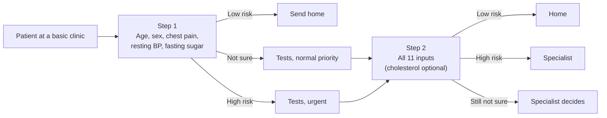

# Two-Step Heart Disease Screening Using Calibrated Stacked Ensemble Classifiers

Class assignment for Advanced Machine Learning, School of Computing and Engineering Sciences, Strathmore University, Nairobi, October 2026.

Authors: Ombiro Zablon B. Handson and Lawrence Kasera.

> Research prototype, not for clinical use. The system is built from one public, historical dataset of 918 patients and has no clinical validation.

- Web app: https://two-step-heart-screening.streamlit.app/

---

## The problem

Heart disease is a leading cause of death. Where heart specialists and exercise-test equipment are scarce, patients must first be sorted using inexpensive measurements. Studies on the Heart Failure Prediction dataset compare classifiers on accuracy from a single split, but accuracy treats both errors alike. In screening the dangerous error is a sick patient sent home.

## What this project does

1. Benchmark. Nine methods (logistic regression, decision tree, random forest, k-NN, RBF-SVM, gradient boosting, a small MLP, an accuracy-weighted soft vote and stacking) are compared on accuracy under nested, repeated stratified cross-validation (3 x 10 outer folds, 5-fold inner tuning, seed 42). Differences are tested with the Friedman test and the corrected resampled t-test.
2. Two-step screening system. Stacking is used as the scorer, with Platt calibration, prior-shift correction to a target prevalence, and a "Not sure" band whose cut-offs come from training-fold out-of-fold scores only.
3. Stress tests. Two baselines, five prevalence scenarios (2, 5, 10, 20 % and the dataset's own 55.3 %) and leave-one-site-out validation on the original UCI files.



## Main results

| Finding | Value |
|---|---|
| Best accuracy (accuracy-weighted soft vote, 11 inputs, nested CV) | 87.72 ± 3.14 % |
| Stacking / random forest | 87.54 ± 3.04 % / 87.43 ± 3.54 % |
| Decision tree (clearly worse) | 83.98 ± 3.28 % |
| Friedman test over nine methods | chi-square = 56.25, p = 2.5 x 10^-9 |
| Soft vote vs random forest, stacking vs random forest | p = 0.66, p = 0.85 (not significant) |

Accuracy cannot separate the strong models, so the contribution of the two-step system is in the screening measures. At an assumed 5 % prevalence, per 1,000 patients:

| Pathway | Equipment tests | Sick patients sent home | Left "not sure" |
|---|---|---|---|
| Two-step system (Step 1 release 95 %) | 521 | 2.9 | 332 |
| Fixed 0.5 cut-off at Step 1 | 317 | 10.9 | 0 |
| Test everyone, forced 0.5 decision | 1,000 | 4.7 | 0 |
| Test everyone, with the "not sure" band | 1,000 | 1.1 | 433 |

Where it fails: the Step 1 cut-off does not transfer cleanly between hospitals (up to 11.3 % of sick patients sent home at one held-out site), and about one third of patients remain "not sure".

---

## Repository layout

```
scripts/     common.py (settings, models, calibration, thresholds), 02_train_models.py, 03_ladder.py,
             04_evaluate.py, 05_site_validation.py, 06_export_models.py, run_all.py, plot_style.py
app/         Streamlit application (app.py, logic.py); trained models in app/models/
tests/       26 tests (pipeline, leakage check, application)
results/     tables (CSV), summary.md, run_log.txt, site-validation log
figures/     figures generated by the scripts
external/    original UCI heart-disease files, used only by the leave-one-site-out validation
dataset/     heart.csv (Heart Failure Prediction dataset)
run_local.sh one-command runner (see below)
requirements.txt  pinned library versions
```

## Quick start

Requirements: macOS or Linux, Python 3.11 to 3.13 (the pinned scikit-learn 1.9.1 needs 3.11 or newer), `bash` and `rsync`. The reported results were produced with Python 3.12.11 and the versions pinned in `requirements.txt`.

```bash
git clone https://github.com/IncognitoGK9/two-step-heart-screening.git
cd two-step-heart-screening

bash run_local.sh            # full study, about 11 minutes (679 s on a 12-core Apple M3 Pro Mac)
bash run_local.sh --test     # the 26 tests
bash run_local.sh --app      # web application at http://localhost:8501
bash run_local.sh --export   # re-export the models used by the application
bash run_local.sh --site     # leave-one-site-out validation only
```

`run_local.sh` copies the code to `~/hf_run`, builds its own virtual environment there (created once and reused), installs the pinned requirements, runs the chosen step and copies `results/`, `figures/` and `app/models/` back. It refuses to run inside a synced folder (Google Drive, iCloud, Dropbox). A faster check of the pipeline is `bash run_local.sh --quick` (one outer repeat).

If you prefer to manage the environment yourself:

```bash
python -m venv .venv && source .venv/bin/activate
pip install -r requirements.txt
python scripts/run_all.py          # full study
python -m pytest tests -q          # tests
streamlit run app/app.py           # application
```

All reported numbers are produced by the scripts and written to `results/*.csv`; nothing is typed in by hand. After a full run, `results/run_log.txt` records the library versions and timings.

## The application

The Streamlit app asks only for the inputs of the current step, rejects implausible values and returns Low risk, High risk or Not sure with the estimated risk at the chosen prevalence. Step 1 uses five inputs from a basic clinic; Step 2 uses all 11 inputs and cholesterol can be marked as not measured. The sidebar sets the assumed prevalence and the Step 1 safety level.

To host your own copy, use [Streamlit Community Cloud](https://share.streamlit.io): sign in with GitHub, choose this repository, branch `main`, main file `app/app.py`, Python 3.12. It installs `requirements.txt`, and the trained models in `app/models/` are part of the repository. GitHub Pages cannot run the app because it needs a Python server.

## Method in brief

- Protocol. 3 x 10 stratified outer folds; 5-fold inner grid search on accuracy; one stratified 80/20 hold-out reported for comparison; seed 42. A unit test flips the test labels and checks that predictions do not change, which would expose leakage.
- Inputs. Step 1: Age, Sex, ChestPainType, RestingBP, FastingBS. Step 2: all 11 inputs. Cholesterol is excluded from Step 1 because it raised the stacking AUROC by only 0.005 (rule fixed in advance: at least 0.01).
- Missing cholesterol. All 172 zero-cholesterol rows come from two sites (Switzerland and VA Long Beach), so zero is treated as missing and imputed with the training-fold median at Step 2.
- Scorer. Logistic-regression combiner on the logits of six classical models' inner out-of-fold probabilities (stacking), then Platt scaling, then prior-shift correction (Saerens et al., 2002).
- "Not sure" band. Two cut-offs from out-of-fold scores: the lower cut-off releases at most a stated share of sick patients to "Low risk" (95 % at Step 1, 98 % at Step 2). A conformal (Mondrian) alternative is compared and the rule is chosen by a pre-specified criterion.
- Statistics. Friedman test, corrected resampled t-test (Nadeau and Bengio), Wilcoxon signed-rank, Wilson intervals.

## Data

- Training data: fedesoriano, *Heart Failure Prediction Dataset*, Kaggle (918 patients, 11 inputs, target `HeartDisease`): https://www.kaggle.com/datasets/fedesoriano/heart-failure-prediction
- Site validation: UCI Machine Learning Repository, *Heart Disease* (Janosi, Steinbrunn, Pfisterer and Detrano), doi 10.24432/C52P4X. The four site files are in `external/`.

## Limitations

A single historical, referral-enriched sample with no clinical validation; prior-shift correction fixes the prevalence, not the case mix; chest-pain type depends on how the question is asked; the cholesterol signal is entangled with the recording site; the 5 % reference prevalence is a US figure; the Step 1 cut-off needs local recalibration; and about one third of patients remain "not sure".
